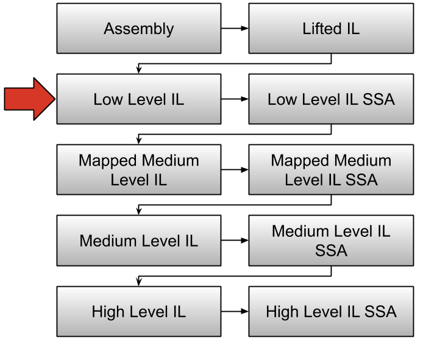
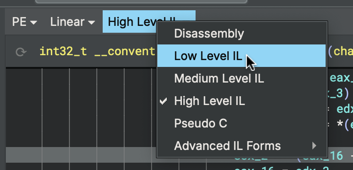

# Binary Ninja Intermediate Language: Low Level IL

Make sure to checkout the [BNIL overview](bnil-overview.md) first if you haven't already. Or feel free to skip to [part 2](bnil-mlil.md) which covers MLIL, or [part 3](bnil-hlil.md) which covers HLIL. This developer guide is intended to cover some mechanics of LLIL to distinguish it from the other ILs in the BNIL family.

If you've already read the introduction, let's get right into the details of LLIL!



The Lifted IL is very similar to the LLIL and is primarily of interest for Architecture plugin authors. If you're writing an analysis plugin, you'll always want to be working at LLIL or higher. During each stage of the lifting process a number of transformations take place, and each layer of IL can have different instructions. Because of this, you can not rely on an instruction from one layer existing in another.

## Introduction by example

Since doing is the easiest way to learn let's start with a simple example binary and step through analyzing it using the python console.



 - Download [chal1](../files/chal1) and open it with Binary Ninja
 - Next, bring up the `Low Level IL` view by clicking in the view drop down at the top of the pane (or alternatively, use the `i` key to cycle view levels)
 - Navigate to main (`g`, then "main", or double-click it in the function list)
 - Finally, bring up the python console using: `~`

Next, enter the following in the console:

```pycon
>>> for block in current_function.low_level_il:
... 	for instr in block:
... 		print (instr.address, instr.instr_index, instr)
...
4196422 0 push(rbp)
4196423 1 rbp = rsp {var_8}
4196426 2 rsp = rsp - 0x110
4196433 3 rax = rbp - 0xc0 {var_c8}
...
```

This will print out all the LLIL instructions in the current function. How does this code work?

First we use the global magic variable `current_function` which gives us the python object [`function.Function`](https://api.binary.ninja/binaryninja.function-module.html#binaryninja.function.Function) for whatever function is currently selected in the UI. The variable is only usable from the python console, and shouldn't be used for headless plugins. In a script you can either use the function that was passed in if you [registered your plugin](https://api.binary.ninja/binaryninja.plugin-module.html#binaryninja.plugin.PluginCommand.register_for_function) to handle functions, or you can compute the function based on [a specific address](https://api.binary.ninja/binaryninja.binaryview-module.html?highlight=get_functions_at#binaryninja.binaryview.BinaryView.get_functions_at), or maybe even just iterate over all the functions in a BinaryView (`for func in bv.functions:`).

Next we get the [`lowlevelil.LowLevelILFunction`](https://api.binary.ninja/binaryninja.lowlevelil-module.html#binaryninja.lowlevelil.LowLevelILFunction) from the `Function` class: `current_function.low_level_il`. Iterating over the `LowLevelILFunction` class provides access to the [`lowlevelil.LowLevelILBasicBlock`](https://api.binary.ninja/binaryninja.lowlevelil-module.html#binaryninja.lowlevelil.LowLevelILBasicBlock) classes for this function. Inside the loop we can now iterate over the `LowLevelILBasicBlock` class which provides access to the individual [`lowlevelil.LowLevelILInstruction`](https://api.binary.ninja/binaryninja.lowlevelil-module.html#binaryninja.lowlevelil.LowLevelILInstruction) classes.

Finally, we can print out the attributes of the instruction. We first print out `address` which is the address of the corresponding assembly language instruction.  Next, we print the `instr_index`, this you can think of as the address of the IL instruction. Since translating assembly language is a many-to-many relationship, we may see multiple IL instructions needed to represent a single assembly language instruction, and thus each IL instruction needs to have its own index separate from its address. Finally, we print out the instruction text.

In python, iterating over a class is a distinct operation from subscripting. This separation is used in the `LowLevelILFunction` class. If you iterate over a `LowLevelILFunction` you get a list of `LowLevelILBasicBlocks`, however if you subscript a `LowLevelILFunction` you actually get the `LowLevelILInstruction` whose `instr_index` corresponds to the subscript:

```pycon
>>> list(current_function.low_level_il)
[<block: x86_64@0x0-0x3f>, <block: x86_64@0x3f-0x45>, <block: x86_64@0x45-0x47>,
 <block: x86_64@0x47-0x53>, <block: x86_64@0x53-0x57>, <block: x86_64@0x57-0x5a>]
>>> type(current_function.low_level_il[0])
<class 'binaryninja.lowlevelil.LowLevelILInstruction'>
>>> current_function.low_level_il[0]
<il: push(rbp)>
```

## Low Level IL Instructions
Now that we've established how to access LLIL Functions, Blocks, and Instructions, let's focus in on the instructions themselves. LLIL instructions are infinite length and structured as an expression tree. An expression tree means that instruction operands can be composed of operation. Thus, we can have an IL instruction like this:

```text
eax = eax + ecx * 4
```

The tree for such an instruction would look like:

```text
   =
  / \
eax  +
    / \
  eax  *
      / \
    ecx  4
```
There are quite a few reasons that we chose to use expression trees that we won't go into in detail here, but suffice it to say lifting to this form and reading this form are both much easier than other forms.

Now let's get back to the examples. First let's pick an instruction to work with:

```pycon
>>> instr = current_function.low_level_il[2]
>>> instr
<il: rsp = rsp - 0x110>
```

For the above instruction, we have a few operations we can perform:

* **address** - returns the virtual address

```pycon
>>> hex(instr.address)
'0x40084aL'
```

* **function** - returns the containing function

```pycon
>>> instr.function
<binaryninja.lowlevelil.LowLevelILFunction object at 0x111c79810>
```

* **instr_index** - returns the LLIL index

```pycon
>>> instr.instr_index
2
```

* **operands** - returns a list of all operands.

```pycon
>>> instr.operands
['rsp', <il: rsp - 0x110>]
```

* **operation** - returns the enumeration value of the current operation

```pycon
>>> instr.operation
<LowLevelILOperation.LLIL_SET_REG: 1>
```

* **src** - returns the source operand

```pycon
>>> instr.src
<il: rsp - 0x110>
```

* **dest** - returns the destination operand

```pycon
>>> instr.dest
'rsp'
```

* **size** - returns the size of the operation in bytes (in this case we have an 8 byte assignment)

```pycon
>>> instr.size
8L
```

Now with some knowledge of the `LowLevelIL` class let's try to do something with it. Let's say our goal is to find all the times the register `rdx` is written to in the current function. This code is straight forward:

```pycon
>>> for block in current_function.low_level_il:
...  for instr in block:
...   if instr.operation == LowLevelILOperation.LLIL_SET_REG and instr.dest.name == 'rdx':
...    print (instr.address, instr.instr_index, instr)
...
4196490 14 rdx = [rax].q
4196500 16 rdx = [rax + 8].q
4196511 18 rdx = [rax + 0x10].q
4196522 20 rdx = [rax + 0x18].q
4196533 22 rdx = [rax + 0x20].q
4196544 24 rdx = [rax + 0x28].q
4196798 77 rdx = [0x602090].q
```

## The Instructions

Going into gross detail on all the instructions is out of scope of this article, but we'll go over the different instructions types and speak generally about how they are used.


### Registers, Constants & Flags

When parsing an instruction tree the terminals are registers, constants and flags. This provides the basis from which all instructions are built.

* `LLIL_REG` - A register, terminal
* `LLIL_CONST` - A constant integer value, terminal
* `LLIL_SET_REG` - Sets a register to the results of the IL operation in `src` attribute.
* `LLIL_SET_REG_SPLIT` - Uses a pair of registers as one double sized register, setting both registers at once.
* `LLIL_SET_FLAG` - Sets the specified flag to the IL operation in `src` attribute.

### Memory Load & Store

Reading and writing memory is accomplished through the following instructions.

* `LLIL_LOAD` - Load a value from memory.
* `LLIL_STORE` - Store a value to memory.
* `LLIL_PUSH` - Store value to stack; adjusting stack pointer by `sizeof(value)` after the store.
* `LLIL_POP` - Load value from stack; adjusting stack pointer by `sizeof(value)` after the store.


### Control Flow & Conditionals

Control flow transferring- and comparison instructions are straightforward enough, but one instruction that deserves more attention is the `if` instruction. To understand the `if` instruction we need to first understand the concept of labels.

Labels function much like they do in C code. They can be put anywhere in the emitted IL and serve as a destination for the `if` and `goto` instructions.  Labels are required because one assembly language instruction can translate to multiple IL instructions, and you need to be able to branch to any of the emitted IL instructions. Let's consider the following x86 instruction `cmove` (Conditional move if equal flag is set):

```nasm
test    eax, eax
cmove  eax, ebx
```

To translate this instruction to IL we have to first create true and false labels. Then we emit the `if` instruction, passing it the proper conditional and labels. Next we emit the true label, then we emit the set register instruction and a goto false label instruction. This results in the following output:

```text
0 @ 00000002 if (eax == 0) then 1 else 3
1 @ 00000002 eax = ebx
2 @ 00000002 goto 3
```

As you can see from the above code, labels are really just used internally and aren't explicitly marked. In addition to `if` and `goto`, the `jump_to` IL instruction is the only other instruction that operates on labels.  The rest of the IL control flow instructions operate on addresses rather than labels, much like actual assembly language instructions. Note that an architecture plugin author should not be emitting `jump_to` IL instructions as those are generated by the analysis automatically.

* `LLIL_JUMP` - Branch execution to the result of the IL operation.
* `LLIL_JUMP_TO` - Jump table construct, contains an expression and list of possible targets.
* `LLIL_CALL` - Branch execution to the result of the IL operation.
* `LLIL_RET` - Return execution to the caller.
* `LLIL_NORET` - Instruction emitted automatically after syscall or call instruction which cause the program to terminate.
* `LLIL_SYSCALL` - System call instruction
* `LLIL_EXCEPTION` - Opaque architectural exception with an unsigned 64-bit `discriminator` for platform interpretation.
* `LLIL_TAILCALL ` - This instruction calls the expression `dest` using `params` as input and `output` for return values
* `LLIL_IF` - `If` provides conditional execution. If condition is true execution branches to the true label and false label otherwise.
* `LLIL_GOTO` - `Goto` is used to branch to an IL label, this is different from jump since jump can only jump to addresses.
* `LLIL_FLAG_COND` - Returns the flag condition expression for the specified flag condition.
* `LLIL_CMP_E` - equality
* `LLIL_CMP_NE` - not equal
* `LLIL_CMP_SLT` - signed less than
* `LLIL_CMP_ULT` - unsigned less than
* `LLIL_CMP_SLE` - signed less than or equal
* `LLIL_CMP_ULE` - unsigned less than or equal
* `LLIL_CMP_SGE` - signed greater than or equal
* `LLIL_CMP_UGE` - unsigned greater than or equal
* `LLIL_CMP_SGT` - signed greater than
* `LLIL_CMP_UGT` - unsigned greater than


### Architectural exception emission

Architecture lifters can emit an exception without selecting an ABI:

```cpp
il.AddInstruction(il.Exception(discriminator));
```

```python
il.append(il.exception(discriminator))
```

Rust lifters use `il.exception(discriminator).append()`. C lifters can use
`BNLowLevelILAddExpr` with `LLIL_EXCEPTION`, size and flags zero, and the discriminator
in operand `0`. Remaining operands are zero.

The discriminator is an architecture-defined unsigned 64-bit constant. Its encoding must
separate architectural events (for example, SVC, HVC, SMC, and BRK) and may include the
instruction's immediate. There is no universal event-number or bit-field allocation.
It is an integer identity, not an IL expression index or a syscall namespace.
C++ exposes `GetDiscriminator()` / `GetDiscriminator<LLIL_EXCEPTION>()`; Python exposes
`.discriminator`, and Rust exposes `.discriminator()` on the `Exception` instruction kind.
Copying and operand enumeration preserve the complete value, and rendering uses
`exception(0x...)`.

Platforms register declarative exception rules using `SetExceptionModel` (C++),
`set_exception_model` (Python), or `BNSetPlatformExceptionModel` (C). Rules match
`(discriminator & mask) == rule.discriminator`. The most specific mask wins; exact rules
can override a kind-wide default. Overlapping rules with equal specificity are rejected.
Setting an existing `(discriminator, mask)` replaces it. Both matches and misses are cached
in core, with a bounded cache invalidated whenever rules change. No platform callback or
Python invocation is needed for analysis lookups.

A rule selects `TrapExceptionModel`, `BreakpointExceptionModel`, or `SystemCallExceptionModel`,
a syscall namespace (only for service calls), and `ContinueAfterException` or
`TerminateAfterException`. Namespace conventions are looked up when needed, so changing a
convention does not leave a stale convention pointer in the exception cache. Register rules
before analysis; after changing them, request function reanalysis to rebuild control flow and IL.

```python
from binaryninja.enums import ExceptionModelKind, ExceptionContinuation
from binaryninja.platform import ExceptionModel

# ARMv7 HVC -> the platform's registered hypervisor ABI in namespace 1.
platform.set_exception_model(2 << 32,
    ExceptionModel(ExceptionModelKind.SystemCallExceptionModel, 1,
        ExceptionContinuation.ContinueAfterException), mask=0xffffffff00000000)
```

ARMv7 and Thumb-2 use `(kind << 32) | immediate`: kind 1 is SVC, 2 HVC, 3 SMC,
and 4 BKPT. The immediate stays in the low 32 bits. The shared architecture helper is
`arch/armv7/exception.h`. These lifters emit `LLIL_EXCEPTION` and report
`ModeledExceptionBranch`, whose `branchTarget` is the discriminator, not a code address.
The existing instruction-info structure and other branch kinds are unchanged. Basic-block
analysis resolves each instruction's `ModeledExceptionBranch` directly through the platform
cache, without lifting temporary LLIL. Platform-dependent control flow for exceptions inside
Thumb IT streams is not modeled in this implementation.

ARMv7 standalone platforms install defaults that concrete platforms snapshot on creation:
SVC, HVC, and SMC are continuing opaque traps for every immediate, including zero;
BKPT is a terminating breakpoint. The architecture does not assign service namespaces
or calling conventions. Both endian variants of ARMv7 and Thumb-2 register one
`smccc32` convention for explicit platform or instruction use. Linux ARM platforms
explicitly select the namespace-0 service model and Linux syscall convention for SVC. Other architecture lifters and legacy
`LLIL_SYSCALL`, `LLIL_BP`, and `LLIL_TRAP` behavior are unchanged.

The AArch32 convention follows the current SMCCC 1.2+ profile in Arm DEN0028 section 2.6:
`r0` carries the complete 32-bit Function Identifier, `r1-r7` carry arguments, and
`r0-r7` can contain up to eight result words. `r4-r7` must be preserved unless the
service defines results there. Without a service definition, analysis conservatively
treats every possible result register as modified. `r8-r14` and SIMD/FP state are
preserved. The convention supplies register-only argument layouts and supports composite
results of up to 32 bytes without hidden return pointers or stack arguments.
It is excluded from ordinary function calling-convention heuristics. Fast and yielding
calls use the same register convention. AArch32 does not support the 64-bit convention
selected by the Function Identifier's bit 30.

AArch64 also exposes `smccc32` for both HVC #0 and SMC #0, using W0-W7, and `smccc64`
for those same instructions, using W0 for the Function Identifier and X1-X17 for payloads.
Its possible results span W0-W7 or X0-X17 respectively. The convention API uses backing
X-register storage with typed layouts for narrow values. Bare AArch64 uses the same opaque
exception policy as ARMv7, with BRK as its terminating breakpoint.

SMCCC requires instruction immediate zero for compliant calls, but zero
alone does not establish that SMCCC applies. A platform that knows its environment uses
SMCCC can explicitly register namespaces and exact exception models:

```python
# IDs 1 and 2 are choices made by this platform, not architecture reservations.
for namespace, kind, name, convention in [
    (1, 2, "hvc", "smccc32"),
    (2, 3, "smc", "smccc32"),
]:
    platform.register_system_call_namespace(namespace, name,
        platform.arch.calling_conventions[convention])
    platform.set_exception_model(kind << 32,
        ExceptionModel(ExceptionModelKind.SystemCallExceptionModel, namespace,
            ExceptionContinuation.ContinueAfterException))
```

Other ABIs can select different conventions, discriminator matches, and continuation
policies. The immediate remains part of the architectural discriminator and is independent
of the SMCCC Function Identifier in `r0`. Concrete platforms inherit any explicitly
registered nonzero namespaces from the standalone platform before installing its exception
rules; namespace 0 remains controlled by the existing syscall APIs. Changing semantic
rules requires reanalysis of existing functions.

Exception rules are consulted only for exception operations. The raw discriminator remains
on `LLIL_EXCEPTION` and `LLIL_EXCEPTION_SSA`, and on the corresponding `MLIL_EXCEPTION` /
`MLIL_EXCEPTION_SSA` and `HLIL_EXCEPTION` / `HLIL_EXCEPTION_SSA` forms. MLIL also has untyped
exception forms while service argument and return layouts are being resolved. These are
independent opcodes; no legacy trap, breakpoint, or syscall operation is reinterpreted.

For individually reported exception events, basic-block analysis and exception IL analysis
consult the same cached rule resolver.
Unknown exceptions conservatively terminate. Continuation applies only to exception
operations, without an attribute that changes the meaning of `TRAP` or `BP`. A service
exception obtains its register effects, argument layout, and namespace-qualified service
name/type from its model and namespace convention. Existing syscall calling-convention
fallbacks and parameter heuristics remain unchanged for directly emitted `SYSCALL`.

The existing IL layouts and opcode numbers are preserved. Exception SSA forms have their
own effect operands and retain the full architectural discriminator. `GetExceptionModelAt`
(C++), `get_exception_model_at` (Python), and `exception_model_at` (Rust) expose a function
instruction's resolved model. Exception origins are saved with function analysis and
restored on database reload.

### Instruction-specific calling conventions

In graph or linear views, select an exception instruction and choose **Set Exception
Calling Convention...** from the context menu. The chooser lists conventions registered
as eligible for the instruction's discriminator. ARMv7 and Thumb (both byte orders) allow
`smccc32` on both HVC #0 and SMC #0, and `linux-syscall` only on
the SVC family. Other conventions require explicit eligibility registration. Exclusion
from automatic function-convention heuristics does not exclude explicit exception selection.
**Use platform default** removes the override. Choices that match the platform default
are omitted, and the context-menu action is hidden when no distinct alternative remains.

Architecture plugins register eligibility separately from ordinary calling conventions:

```python
for kind in (2, 3):
    arch.register_exception_calling_convention(arch.calling_conventions["smccc32"], kind << 32)
arch.register_exception_calling_convention(arch.calling_conventions["linux-syscall"],
    1 << 32, mask=0xffffffff00000000)
eligible = arch.get_eligible_exception_calling_conventions(discriminator)
```

Rules match `(discriminator & mask) == registered_discriminator`; the default mask is
an exact 64-bit match. Multiple rules for one convention are ORed, duplicate registrations
are idempotent, and query lists contain each convention once. Registration requires an
already registered convention on the same architecture with integer argument registers
and an integer return register. Rules are stored natively, so lookups invoke no Python
callbacks. `is_exception_calling_convention_eligible` checks one convention;
`unregister_exception_calling_convention` removes one rule. Register these rules during
plugin initialization; they are not stored in the database. After removing a rule, request
reanalysis to rebuild existing IL. Stored overrides without a matching rule are inactive
and can still be cleared. Eligibility does not automatically assign any convention and
does not alter platform namespace models or ordinary function/call-site convention selection.
The core instruction-override setter enforces the same rules as the menu.

LLIL SSA conservatively retains all candidate register inputs described by an exception
convention. Register capacity alone does not establish service arity. Untyped exception
argument recovery uses the ordinary evidence-based heuristics by default, including for
Linux and Apple syscall conventions; unsupported trailing entry values are discarded from
higher IL without changing the raw LLIL dependencies. A known service prototype determines
argument count and types.

Profiles may explicitly enable full-input forwarding before analysis with
`CallingConvention::SetExceptionArgumentForwarding(true)` (C++),
`BNSetExceptionArgumentForwarding` (C), or `set_exception_argument_forwarding` on the Rust
core convention. Python custom conventions declare `exception_argument_forwarding = True`;
core convention wrappers expose the same property. Reanalyze existing functions after
changing a profile's policy. SMCCC and Samsung uH enable this policy, so an `hvc; ret`
wrapper can forward incoming registers without local assignments. It only affects untyped
exception argument recovery, and a known service prototype takes precedence.
Non-SSA LLIL still shows only the exception discriminator's presentation; recovered
arguments appear in higher IL forms.

The choice applies only to that instruction in that function. It takes precedence over
the platform namespace's convention and supplies argument locations and register effects
even when the platform models the exception as an opaque trap. It does not register a
namespace, infer a service name, or change the platform's continuation policy. Other
instructions with the same discriminator remain unchanged. Overrides are saved in the
analysis database and support undo/redo.

```python
function.set_user_exception_calling_convention(address,
    function.arch.calling_conventions["smccc32"])
bv.update_analysis_and_wait()

# Restore inheritance from the platform.
function.set_user_exception_calling_convention(address, None)
bv.update_analysis_and_wait()
```

`get_user_exception_calling_convention` returns only the explicit override;
`get_exception_calling_convention_at` returns the effective convention. The existing
`get_exception_model_at` still returns the platform's categorization, namespace, and
continuation policy. `get_exception_discriminator_at` also identifies exception sites
that have no platform model. C, C++, and Rust expose corresponding function APIs.

### Exception display rules

Platforms can name exception operations independently of their semantic models. Display
rules use the same discriminator/mask matching and specificity rules as exception models,
with a separate bounded native cache. They do not change calling conventions, continuation,
IL operands, or the discriminator. No Python callback runs during rendering.

```python
# HVC family: show its architectural immediate, rather than the packed discriminator.
platform.set_exception_display(2 << 32, name="hvc", mask=0xffffffff00000000,
    value_mask=0xffffffff)

# One platform-specific event: omit the discriminator from the displayed operands.
platform.set_exception_display((4 << 32) | 0x42, name="warn_once")
```

`value_mask=None` (the default) omits the displayed discriminator. Otherwise the first
displayed value is `(discriminator & value_mask) >> value_shift`, with shifts from 0 to 63.
A zero mask displays zero; it is distinct from omitting the value. The matching mask and
value-extraction mask are independent. Ordinary IL arguments, outputs, and SSA memory
annotations continue to render normally. Service names are still resolved using the
exception model's namespace.

ARMv7 standalone platforms register `svc`, `hvc`, `smc`, and `bkpt` display defaults that
show the immediate in the low 32 bits. Concrete platforms snapshot those defaults on
creation, and can replace a family or override an exact event. Raw LLIL without a function
owner uses the architecture's standalone display rules. An unmatched event retains the
`exception(0x...)` fallback, including the full unsigned discriminator.

The same rules apply to LLIL, SSA, MLIL (including untyped forms), HLIL, pseudo-C, and
pseudo-Rust. Existing IL objects pick up display changes on their next render; refresh the
view to display the new text. Function reanalysis is unnecessary for presentation changes.
The full value remains accessible through each exception instruction's `discriminator`.

Python exposes `get_exception_display`, `remove_exception_display`, and the owned
`exception_displays` list. C/C++ provide the corresponding platform get/set/remove/list
APIs. C getter/list results own their names and must be released using
`BNFreeExceptionDisplay` or `BNFreeExceptionDisplayRuleList`; setters copy input names.
Rust exposes owned `ExceptionDisplay` and `ExceptionDisplayRule` structs and platform
registry methods. Display and semantic rules are registered again by the platform plugin
when it initializes; display rules are not stored in the analysis database.


### The Arithmetic & Logical Instructions

LLIL implements the most common arithmetic as well as a host of more complicated instruction which make translating from assembly much easier. Most arithmetic and logical instruction contain `left` and `right` attributes which can themselves be other IL instructions.

The double precision instruction multiply, divide, modulus instructions are particularly helpful for instruction sets like x86 whose output/input can be double the size of the input/output.

* `LLIL_ADD` - Add
* `LLIL_ADC` - Add with carry
* `LLIL_SUB` - Subtract
* `LLIL_SBB` - Subtract with borrow
* `LLIL_AND` - Bitwise and
* `LLIL_OR` - Bitwise or
* `LLIL_XOR` - Exclusive or
* `LLIL_LSL` - Logical shift left
* `LLIL_LSR` - Logical shift right
* `LLIL_ASR` - Arithmetic shift right
* `LLIL_ROL` - Rotate left
* `LLIL_RLC` - Rotate left with carry
* `LLIL_ROR` - Rotate right
* `LLIL_RRC` - Rotate right with carry
* `LLIL_MUL` - Multiply single precision
* `LLIL_MULU_DP` - Unsigned multiply double precision
* `LLIL_MULS_DP` - Signed multiply double precision
* `LLIL_DIVU` - Unsigned divide single precision
* `LLIL_DIVU_DP` - Unsigned divide double precision
* `LLIL_DIVS` - Signed divide single precision
* `LLIL_DIVS_DP` - Signed divide double precision
* `LLIL_MODU` - Unsigned modulus single precision
* `LLIL_MODU_DP` - Unsigned modulus double precision
* `LLIL_MODS` - Signed modulus single precision
* `LLIL_MODS_DP` - Signed modulus double precision
* `LLIL_NEG` - Sign negation
* `LLIL_NOT` - Bitwise complement
* `LLIL_BSWAP` - Reverse the byte order of `src`
* `LLIL_POPCNT` - Population count (number of set bits) of `src`
* `LLIL_CLZ` - Count leading zero bits of `src`; the result is `8 * size` when `src` is zero
* `LLIL_CTZ` - Count trailing zero bits of `src`; the result is `8 * size` when `src` is zero
* `LLIL_RBIT` - Reverse the bit order of `src`
* `LLIL_CLS` - Count leading sign bits of `src` (the number of bits below the sign bit that match it)
* `LLIL_MINS` - Signed minimum of `left` and `right`
* `LLIL_MAXS` - Signed maximum of `left` and `right`
* `LLIL_MINU` - Unsigned minimum of `left` and `right`
* `LLIL_MAXU` - Unsigned maximum of `left` and `right`
* `LLIL_ABS` - Signed absolute value of `src`
* `LLIL_TEST_BIT ` - Test if bit `right` in expression `left` is set
* `LLIL_BOOL_TO_INT ` - Converts a bool `src` to an integer

### Floating Point Operations
* `LLIL_FLOAT_CONST` - Floating point constant value
* `LLIL_FADD` - Floating point add
* `LLIL_FSUB` - Floating point subtraction
* `LLIL_FMUL` - Floating point multiplication
* `LLIL_FDIV` - Floating point division
* `LLIL_FSQRT` - Floating point square root
* `LLIL_FNEG` - Floating point negate
* `LLIL_FABS` - Floating point absolute value
* `LLIL_FLOAT_TO_INT` - Floating point convert a floating point to an integer
* `LLIL_INT_TO_FLOAT` - Floating point convert an integer to a floating point
* `LLIL_FLOAT_CONV` -
* `LLIL_ROUND_TO_INT` - Rounds to the nearest integer
* `LLIL_FLOOR` - Returns the floor of a floating point value
* `LLIL_CEILING` - Returns the ceiling of a floating point value
* `LLIL_FTRUNC` - Computes the floating point truncation of the IEEE754 number in `src`

### Floating Point Conditionals

These are identical to their native counterparts but are lifted separately so that the operations can impact different flags. See [Control Flow & Conditionals](#control-flow-conditionals) above.

* `LLIL_FCMP_E ` - See above
* `LLIL_FCMP_NE ` - See above
* `LLIL_FCMP_LT ` - See above
* `LLIL_FCMP_LE ` - See above
* `LLIL_FCMP_GE ` - See above
* `LLIL_FCMP_GT ` - See above
* `LLIL_FCMP_O ` - See above
* `LLIL_FCMP_UO ` - See above

### Special instructions

The rest of the instructions are pretty much self-explanatory to anyone with familiarity with assembly languages.

* `LLIL_BP` - Breakpoint instruction
* `LLIL_EXTERN_PTR` - A synthesized (fake) pointer to something which doesn't exist within the memory space of the current binary
* `LLIL_INTRINSIC ` - Intrinsics are operations with `output` and `params` and an `intrinsic` where the exact behavior is not modelled but the dataflow system can be improved by annotating the inputs and outputs. An example intrinsic would CPU AES instructions where the exact behavior is not modelled, but the inputs and outputs are.
* `LLIL_INTRINSIC_SSA ` - SSA form of the `LLIL_INTRINSIC` operation
* `LLIL_MEMORY_INTRINSIC_SSA ` - Memory versioning SSA form of the `LLIL_INTRINSIC` operation
* `LLIL_NOP` - No operation
* `LLIL_SX` - Sign extend
* `LLIL_TRAP` - Trap instruction
* `LLIL_UNDEF` - Undefined instruction
* `LLIL_UNIMPL` - Unimplemented instruction
* `LLIL_UNIMPL_MEM` - Unimplemented memory access instruction
* `LLIL_ZX` - Zero extend
* `LLIL_MEM_PHI ` - A memory `PHI` represents memory modifications that could have occured down different source basic blocks similar to a `VAR_PHI`.
* `LLIL_LOW_PART ` - `size` bytes from the low end of `src` expression

### Currently Undocumented

* `LLIL_FLAG ` -
* `LLIL_FLAG_BIT ` -
* `LLIL_FLAG_GROUP ` -
* `LLIL_FLAG_BIT_SSA ` -
* `LLIL_FLAG_PHI ` -
* `LLIL_FLAG_SSA ` -
* `LLIL_TAILCALL_SSA ` -
